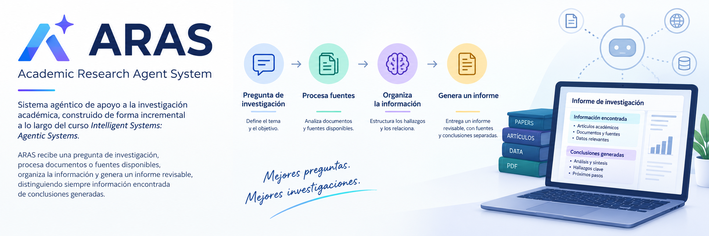

# ARAS — Academic Research Agent System

Sistema agéntico de apoyo a la investigación académica, construido de forma
incremental a lo largo del curso **Intelligent Systems: Agentic Systems**.

ARAS recibe una **pregunta de investigación**, procesa documentos o fuentes
disponibles, organiza la información y genera un **informe revisable**,
distinguiendo siempre **información encontrada** de **conclusiones generadas**.


## Arquitectura

```text
Pregunta de investigación
          │
          ▼
  LLM + ingeniería de prompts          → Módulos 1 y 2
          │
          ▼
   Pipeline de procesamiento (LangChain) → Módulo 3
          │
          ▼
     Agente coordinador                → Módulo 4
          │
          ├─ Herramientas MCP          → Módulo 5
          │
          └─ Agentes especializados    → Módulo 6
          │
          ▼
   Verificación de resultados          → Módulo 7
          │
          ▼
     Informe final + trazabilidad
```

## Estructura del repositorio

- `docs/` — propuesta del curso y material de referencia.
- `notebooks/` — laboratorios Jupyter, un cuaderno (o dos) por módulo.
- `src/aras/` — código fuente del sistema:
  - `skills/` — registro y ejecución de los *skills* académicos.
  - `mcp/` — servidor MCP que expone los *skills* como herramientas.
  - `crewmaster/` — equipo multiagente (orquestador + 4 agentes) con CrewMaster.
- `tests/` — pruebas automatizadas.

Consulta [`notebooks/README.md`](notebooks/README.md) para la guía de los
laboratorios y las instrucciones de instalación y ejecución.

## Sistema multiagente con CrewMaster

`src/aras/crewmaster/` implementa un **orquestador** cuyo objetivo es generar
un **artículo científico** sobre un tema, coordinando un equipo de 4 agentes:

```text
article_orchestrator (produce: ScientificArticle)
        │
        ├─ 1. gather      → GatheredSources   (identifica y recopila información)
        ├─ 2. analyze     → Analysis          (analiza los resultados)
        ├─ 3. review      → ReviewResult      (revisa consistencia y vacíos)
        └─ 4. synthesize  → ScientificArticle (redacta el artículo final)
```

- Cada agente es una `Operation` con `AgentConfig`, bloques de prompt (`.j2`) y
  salida tipada (Pydantic). Las dependencias se expresan con `consumes`.
- El modelo local se conecta mediante `OllamaDriver` (implementa el
  `RuntimeDriver` de CrewMaster).

Ejecución (con Ollama corriendo y el modelo descargado):

```bash
pip install -r requirements-crewmaster.txt
pip install crewmaster==2.0.1 --no-deps
PYTHONPATH=src python -m aras.crewmaster.run \
  --topic "Retrieval-Augmented Generation for systematic reviews" --model llama3.2
```

Los tests usan un `FakeDriver` (sin Ollama) para validar el DAG y el orden de
ejecución de los 4 agentes.

## Tests

Los tests verifican la **conexión con los skills académicos** (registro,
ejecutor y servidor MCP):

```bash
pip install pytest mcp
python -m pytest -v
```

- `tests/test_skills_registry.py` — descubrimiento, parseo de frontmatter y
  conexión real con `~/.pi/agent/skills`.
- `tests/test_skills_executor.py` — ejecución en `dry_run` y degradación
  elegante sin Ollama.
- `tests/test_mcp_skill_server.py` — herramientas MCP registradas
  (`listar_skills`, `ejecutar_skill` y una por cada skill).
- `tests/test_crewmaster_article.py` — equipo multiagente CrewMaster
  (orquestador + 4 agentes) con `FakeDriver`, sin Ollama.
